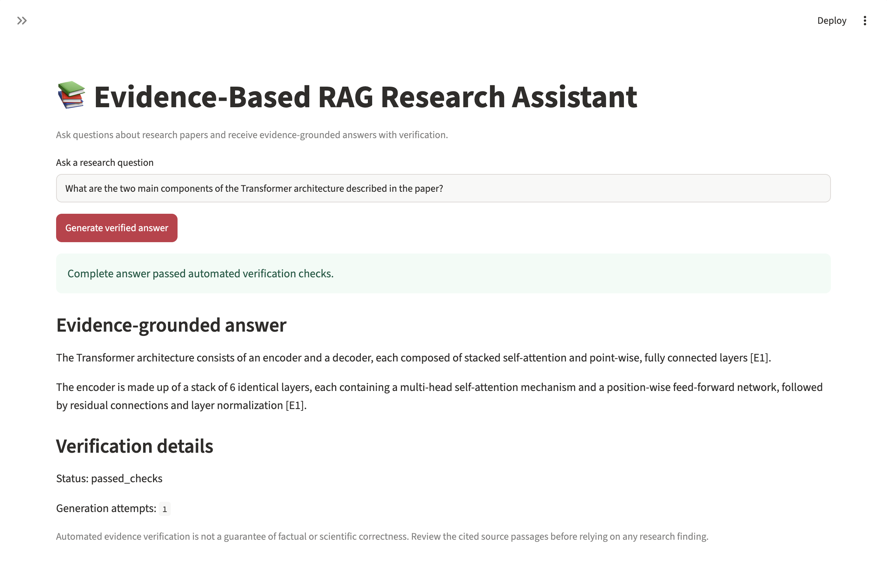
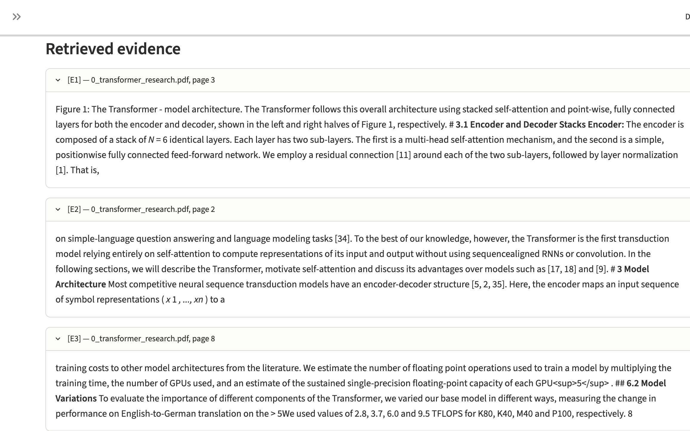
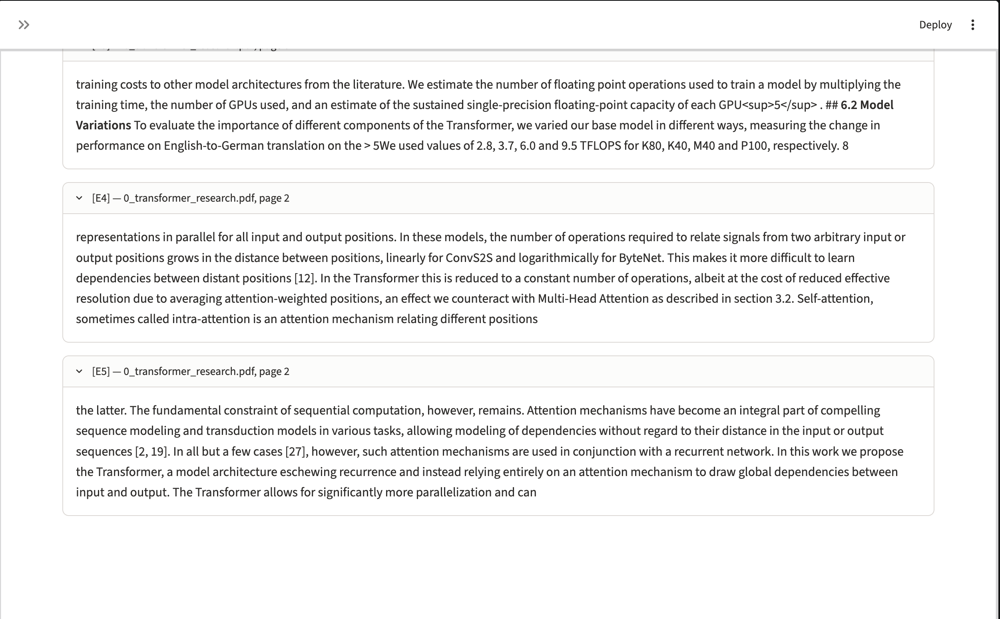

# Evidence-Based RAG Research Assistant

An evidence-grounded research assistant that answers questions from uploaded PDF documents using Retrieval-Augmented Generation (RAG), local large language models, semantic claim verification, and citation validation.

The project focuses on making AI-generated research answers more traceable, verifiable, and reliable.

## Key Features

- **Multi-PDF ingestion:** Extracts and processes text from uploaded research documents.
- **Evidence retrieval:** Uses BM25 search to identify relevant document passages.
- **Cross-encoder reranking:** Reorders retrieved passages to improve evidence selection.
- **Local LLM generation:** Uses Ollama with Qwen2.5 for document-grounded answers.
- **Citation validation:** Checks whether generated answers reference valid evidence identifiers.
- **Semantic verification:** Uses natural language inference (NLI) to assess whether cited passages support generated claims.
- **Retry and recovery:** Retries unsuccessful generations and supports partially verified answers when appropriate.
- **Safe fallback:** Avoids presenting an unverified answer as evidence-grounded.
- **Streamlit interface:** Provides document upload, question answering, verification status, and expandable evidence.
- **Automated testing:** Includes unit and integration tests for retrieval, generation, and verification components.

## System Architecture

```text
PDF Documents
     |
     v
PDF Text Extraction
     |
     v
Text Chunking and Quality Filtering
     |
     v
BM25 Evidence Retrieval
     |
     v
Cross-Encoder Reranking
     |
     v
Local LLM (Ollama + Qwen2.5)
     |
     v
Citation and Semantic Claim Verification
     |
     +---- Verified Answer
     |
     +---- Retry / Partial Recovery
     |
     +---- Safe Fallback
     |
     v
Streamlit Research Interface
```

## Technology Stack

| Component | Technology |
|---|---|
| Programming language | Python |
| Application interface | Streamlit |
| Local LLM runtime | Ollama |
| Language model | Qwen2.5 |
| PDF processing | PyMuPDF |
| Keyword retrieval | BM25 |
| Passage reranking | Cross-Encoder |
| Claim verification | Natural Language Inference (NLI) |
| Dependency management | uv |
| Automated testing | pytest |
| Code quality | Ruff |

## Project Structure

- `app.py` — Streamlit application.
- `src/evidence_rag/ingestion/` — PDF loading, chunking, and filtering.
- `src/evidence_rag/retrieval/` — Search and reranking.
- `src/evidence_rag/generation/` — LLM generation and answer recovery.
- `src/evidence_rag/verification/` — Citation and semantic verification.
- `src/evidence_rag/evaluation/` — Evaluation utilities and metrics.
- `scripts/` — Experiments, diagnostics, and benchmarks.
- `tests/` — Automated tests.

## Verification Philosophy

The assistant distinguishes between answers that pass automated verification, answers that are only partially verified, and answers for which sufficient support cannot be established.

Automated verification reduces unsupported claims but does not guarantee scientific or factual correctness. Users should review the original cited evidence before relying on generated answers.

## Development Status

Active development. Core document ingestion, retrieval, reranking, local answer generation, verification, and Streamlit functionality have been implemented.

## Author

Paulin Binusha Sahayaranjan

GitHub: [Binusha28](https://github.com/Binusha28)

## Getting Started

### Prerequisites

- Python 3.12
- [uv](https://docs.astral.sh/uv/) for Python dependency management
- [Ollama](https://ollama.com/) installed and running
- Sufficient memory and disk space for the language model and semantic verification models

### 1. Clone the Repository

```bash
git clone https://github.com/Binusha28/evidence-rag-assistant.git
cd evidence-rag-assistant
```

### 2. Install Python Dependencies

```bash
uv sync
```

The project requires Python 3.12. The `uv` dependency manager installs the packages specified in `pyproject.toml` and `uv.lock`.

### 3. Download the Local Language Model

```bash
ollama pull qwen2.5:3b
```

Ensure the Ollama service is running before launching the application. The default language model is Qwen2.5 3B.

### 4. Launch the Research Assistant

```bash
uv run streamlit run app.py
```

Open the local URL displayed by Streamlit, typically `http://localhost:8501`.

### 5. Use the Application

1. Upload one or more research papers in PDF format.
2. Wait for document extraction, indexing, and model initialization.
3. Enter a research question about the uploaded documents.
4. Review the generated answer and its verification status.
5. Expand the evidence passages to inspect the supporting source text.

### 6. Run Automated Tests

```bash
uv run pytest -q
```

### 7. Check Code Quality

```bash
uv run ruff check .
uv run ruff format --check .
```

## Important Limitations

- The assistant runs locally and requires Ollama and its configured model.
- Initial model downloads and loading can take time.
- Automated semantic verification is not a guarantee of factual correctness.
- Answer quality depends on the uploaded documents, retrieved passages, and language model.
- The system is a research prototype, not a substitute for expert review or professional decision-making.

## Application Demonstration

The following screenshots show an end-to-end test using the research paper *Attention Is All You Need*.

### 1. Evidence-Grounded Answer

The assistant identifies the encoder and decoder as the two main components of the Transformer architecture. The generated answer includes evidence citations and passes automated verification in one generation attempt.



### 2. Retrieved Supporting Evidence

Retrieved passages are displayed with citation identifiers, source document names, and page numbers so users can inspect the evidence supporting the generated answer.



### 3. Additional Retrieved Passages

The interface also displays additional retrieved passages to provide transparency into the evidence available during answer generation.



**Note:** Passing automated verification indicates that the generated claims met the configured evidence checks. It does not guarantee factual correctness or complete coverage of every research question.
